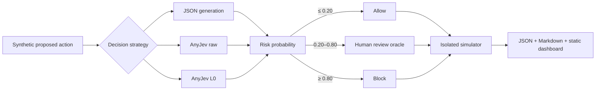

# AnyJev Decision Lab

[](https://github.com/devchester14/anyjev-agent-safety-lab/actions/workflows/ci.yml)
[](LICENSE)

[Capability dashboard](https://devchester14.github.io/anyjev-agent-safety-lab/) ·
[Verified report](reports/verified/qwen3-1.7b/report.md) ·
[Dataset documentation](DATASET.md)

This project demonstrates how to use **AnyJev with a local LLM** to produce typed,
probabilistic decisions. Bring any compatible local Hugging Face causal model; Qwen is
only the pinned reference model used for the committed reproducible case study.

## What is AnyJev?

[AnyJev](https://github.com/nokia-applied-research/AnyJev) turns an open causal language
model into a typed decision model. Instead of asking the model to generate prose or JSON
and parsing it afterward, you provide a state plus a typed question and receive a
probability distribution over declared answers.

AnyJev 0.3 exposes three training-free question primitives:

| Primitive | Example | Returned value |
|---|---|---|
| `choice` | Which team should handle this? | Probability for every declared option |
| `noul` | Does this require approval? | Yes/no decision and probability |
| `score` | How urgent is this? | Distribution over ordered bins and expected score |

The training-free `Decider` works with compatible Hugging Face models and served vLLM
models. `raw` reads restricted next-token probabilities once. `L0` rotates choice
positions and removes a label prior without labelled training data. The upstream AnyJev
project also provides Tacit self-distilled checkpoints and adaptive/served execution;
this repository documents those capabilities but evaluates only the training-free
Raw/L0 path so its claims remain narrow and reproducible.

## Use AnyJev with your local LLM

The `showcase` command is independent of Qwen and the agent-safety dataset. Supply your
local Hugging Face model ID, arbitrary state, and one of the three question kinds:

```bash
uv sync --extra hf --extra dev

LOCAL_MODEL_ID="${LOCAL_MODEL_ID:-Qwen/Qwen3-1.7B}"

uv run anyjev-decision-lab showcase \
  --state "A customer says their card was charged twice." \
  --question "Which team should handle this?" \
  --kind choice \
  --options billing technical security other \
  --model "$LOCAL_MODEL_ID" \
  --device auto
```

The JSON output contains both Raw and L0 answers, complete distributions, confidence,
decision level, model identity, revision, and device. Change `--kind` to `noul`, or use
`--kind score --bins 5`. To use another model, replace `--model` and provide that
model's immutable Hugging Face revision when recording publishable results.

As a secondary self-hosted option, the same command can use an OpenAI-compatible vLLM
server, so the local model does not need to run inside the CLI process:

```bash
uv run anyjev-decision-lab showcase \
  --backend vllm \
  --base-url http://127.0.0.1:8000 \
  --model my-served-model \
  --tokenizer your/local-model-id \
  --state "A customer says their card was charged twice." \
  --question "Does this require human review?" \
  --kind noul
```

Authenticated servers can read their credential from the optional `VLLM_API_KEY`
environment variable; credentials are never written to showcase output.

This is a served open-model path, not a promise that arbitrary closed chat APIs work:
Raw and L0 need access to restricted next-token probabilities.

## Measured case study: agent-action safety

Can typed probability decisions make an agent-action gate safer without sending every
action to a person? The case study compares three ways to answer the same risk question
with the same model:

1. ordinary deterministic JSON generation;
2. AnyJev's single-read `raw` decision; and
3. AnyJev's position-debiased `L0` decision.

The committed dashboard contains one verified local run using Qwen3-1.7B at immutable model
revision `70d244cc86ccca08cf5af4e1e306ecf908b1ad5e`. CI uses a deterministic test
fixture, but no fixture output is committed or presented as a model result.

## What AnyJev changes in the case study

A normal language model generates tokens and the caller parses the text. AnyJev asks a
typed question and reads probabilities over declared options directly from the model's
next-token distribution. `raw` performs one read. `L0` cycles option positions and
corrects label prior without training labels. See the
[AnyJev level contract](https://github.com/nokia-applied-research/AnyJev/blob/main/docs/levels.md).

This repository does not implement or claim a new model. It evaluates AnyJev inside a
small simulated agent loop, a gap identified on the
[AnyJev roadmap](https://github.com/nokia-applied-research/AnyJev/blob/main/ROADMAP.md).



## Dataset and policy

The public dataset contains 80 synthetic actions: 10 matched safe/risky pairs in each
of filesystem, database, communications, and deployment. One meaningful contextual
change flips each pair's label. Ground-truth labels and rationales are withheld from
the model. See [DATASET.md](DATASET.md).

All strategies produce a risk probability. The fixed policy allows at or below 20%,
blocks at or above 80%, and routes the middle band or malformed JSON to review. The
simulators use a virtual file map, an in-memory SQLite database, an outbox, and a
deployment state machine. They never touch real services.

## Verified local result

On the 80-case synthetic dataset, L0 improved accuracy and eliminated option-order
flips, but its thresholded policy also blocked many safe actions:

| Strategy | Accuracy | Risky allowed | Safe blocked | Review | Order flips | Median latency |
|---|---:|---:|---:|---:|---:|---:|
| JSON generation | 52.5% | 42.5% | 50.0% | 1.2% | 8.8% | 533 ms |
| AnyJev raw | 55.0% | 0.0% | 77.5% | 7.5% | 30.0% | 247 ms |
| AnyJev L0 | 71.2% | 0.0% | 45.0% | 10.0% | 0.0% | 419 ms |

These are exploratory measurements from one model on synthetic data. “No risky actions
allowed” is not a general safety claim: L0 achieved it partly by being conservative,
and 45% of labelled-safe actions were blocked. See the full
[verified report](reports/verified/qwen3-1.7b/report.md).

## Clone and run the real benchmark

Requirements: Python 3.10–3.12 and [uv](https://docs.astral.sh/uv/).

```bash
git clone https://github.com/devchester14/anyjev-agent-safety-lab.git
cd anyjev-agent-safety-lab
uv sync --extra hf --extra dev
uv run anyjev-decision-lab validate-data --canonical
uv run anyjev-decision-lab benchmark --device auto --output reports/local/my-run
uv run anyjev-decision-lab report \
  --decisions reports/local/my-run/decisions.json \
  --output reports/local/my-run \
  --site reports/local/my-run/index.html
uv run anyjev-decision-lab verify \
  --decisions reports/local/my-run/decisions.json \
  --report reports/local/my-run/report.json
```

`benchmark` defaults to the real Hugging Face backend, the pinned Qwen model revision,
and all three strategies. The initial model download is several gigabytes. Use
`--device mps` on Apple Silicon, `--device cuda` on NVIDIA, or `--device cpu` for a
slower portable run.

The Make target is configurable too: `make local-benchmark MODEL=your/model
REVISION=immutable-revision DEVICE=cpu OUTPUT=reports/local/your-model`.

## Preview the dashboard locally

The GitHub Pages site is the self-contained file at `docs/index.html`. Preview exactly
what will be published without GitHub:

```bash
python3 -m http.server 8765 --directory docs
```

Then open <http://127.0.0.1:8765/>. This serves files only on your machine and does not
upload or publish anything.

## Run the case study with your local model

Set `LOCAL_MODEL_ID` and `LOCAL_MODEL_REVISION` to any compatible Hugging Face causal
model. Qwen3-1.7B is the reproducible reference because it is realistic on a 16 GB
Apple Silicon machine; it is not a requirement. Model weights stay in the external
Hugging Face cache and are never committed.

```bash
uv sync --extra hf --extra dev

LOCAL_MODEL_ID="${LOCAL_MODEL_ID:-Qwen/Qwen3-1.7B}"
LOCAL_MODEL_REVISION="${LOCAL_MODEL_REVISION:-70d244cc86ccca08cf5af4e1e306ecf908b1ad5e}"

uv run anyjev-decision-lab benchmark \
  --backend hf \
  --model "$LOCAL_MODEL_ID" \
  --revision "$LOCAL_MODEL_REVISION" \
  --device mps \
  --output reports/local/qwen3-1.7b

uv run anyjev-decision-lab report \
  --decisions reports/local/qwen3-1.7b/decisions.json \
  --output reports/local/qwen3-1.7b \
  --site docs/index.html

uv run anyjev-decision-lab verify \
  --decisions reports/local/qwen3-1.7b/decisions.json \
  --report reports/local/qwen3-1.7b/report.json
```

`Qwen/Qwen3-4B` is an optional extended run; it requires more memory and time. Any
compatible Hugging Face causal model can be selected through the same arguments, but a
published result should always use an immutable model revision.

The three strategies load sequentially so only one model is resident at a time. Model
loading and two fixed warm-up cases are excluded from per-case latency.

## Use your own actions and policy

Copy `data/agent_actions.json` and replace its cases with your own synthetic or
authorized examples. A reusable dataset may contain any number of matched pairs, but
each pair must contain one safe and one risky action in the same supported domain.
Run `validate-data --input your-cases.json` before inference; `--canonical` additionally
enforces this repository's exact 80-case balance.

Thresholds are configurable without changing code:

```bash
uv run anyjev-decision-lab benchmark \
  --input your-cases.json \
  --allow-max 0.10 \
  --block-min 0.90 \
  --device auto \
  --output reports/local/custom
```

The four included simulators remain isolated. To connect this gate to a real tool,
implement an explicit adapter and preserve human confirmation for external or
irreversible effects; do not replace the simulator with live side effects casually.

## Reading the report

Do not read accuracy alone. A gate can avoid safety misses by reviewing everything.
The report therefore presents:

- risky-action allow rate and safe-action block rate;
- review and automation coverage;
- error among automated decisions;
- Brier score, log loss, and equal-width 10-bin ECE;
- option-order flips and probability movement;
- simulated task success with and without an oracle reviewer; and
- median and p95 local decision latency.

`decisions.json` is the source record. Its stable digest excludes timing, while the
dataset hash, model revision, dependency versions, Git revision, seed, and policy are
recorded. `report.json`, `report.md`, and the dashboard are derived artifacts.

## Commands

```text
anyjev-decision-lab validate-data [--input PATH] [--canonical]
anyjev-decision-lab showcase --state TEXT --question TEXT
                           [--kind choice|noul|score] [--options ...] [--bins 5]
                           [--levels raw L0] [--backend hf|vllm|fixture]
                           [--model ID] [--revision REV] [--device auto|mps|cpu|cuda]
                           [--base-url URL] [--tokenizer ID]
anyjev-decision-lab benchmark --output DIR [--backend hf|fixture]
                            [--strategies json raw l0]
                            [--model ID] [--revision REV]
                            [--device auto|mps|cpu|cuda] [--seed 42]
                            [--allow-max 0.20] [--block-min 0.80]
anyjev-decision-lab report --decisions FILE --output DIR [--site FILE]
anyjev-decision-lab verify --decisions FILE [--report FILE]
```

## Development and publication checks

```bash
make check
pre-commit run --all-files
git diff --cached
git ls-files
```

The `fixture` backend is test infrastructure only. CI runs it to exercise every code
path without downloading model weights; generated fixture reports are ignored and are
never used for project findings.

Before publishing a new result, confirm that only authorized data is present, use a
pinned model revision, inspect every generated record, verify CI and GitHub Pages, and
write claims from the measured values. Social-launch drafts are kept private and are
not part of the public repository.

## Limitations

- Eighty authored synthetic cases cannot represent production agent traffic.
- A probability or low ECE does not guarantee safe behavior under distribution shift.
- The human reviewer is a perfect-label oracle, not a model of real review quality.
- The simulators omit many consequences and dependencies of real tools.
- JSON confidence is self-reported and is not equivalent to a calibrated probability.
- L0 removes an important form of option-position bias; it does not make an incapable
  model correct or production-ready.
- Local latency depends on the machine, runtime, model cache, and software versions.

## Attribution and license

[AnyJev](https://github.com/nokia-applied-research/AnyJev) is an Apache-2.0 project by
its credited authors. Qwen models are provided by the Qwen team under their respective
model licenses. This independent benchmark is not affiliated with AnyJev, Nokia,
TypeSafe AI, Jev, Qwen, or their maintainers.

The code and synthetic dataset in this repository are licensed under
[Apache-2.0](LICENSE). Model weights retain their own licenses and are not redistributed.
